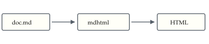

# mdhtml showcase

Everything `mdhtml` renders, on one page.
Frontmatter above this heading should be gone.[^1]

## Sidenotes

The reason `mdhtml` stays in this repo.
Sidenotes come from `mdsidenote` and should sit in the right margin, numbered.<label for="sidenote-1" class="margin-toggle sidenote-number"></label>
<input type="checkbox" id="sidenote-1" class="margin-toggle"/>
<span class="sidenote"><span class="hidden">(</span>This is a sidenote. It should align with the paragraph that references it, not float to the bottom.<span class="hidden">)</span></span>
A second reference sits here.<label for="sidenote-2" class="margin-toggle sidenote-number"></label><input type="checkbox" id="sidenote-2" class="margin-toggle"/><span class="sidenote"><span class="hidden">(</span>A second sidenote, so two hung numerals can be compared for a shared right edge.<span class="hidden">)</span></span>
Narrow the window below 1000px and it should collapse into a tap-to-reveal note.

## Alerts

> [!NOTE]
> Useful information a reader should notice.

> [!WARNING]
> Something that needs attention.

> An ordinary blockquote, for contrast.

## Task lists

- [x] checkbox replaces the bullet
- [ ] unchecked
- an ordinary item keeps its bullet
  - a nested item, one level down
    - and two levels down

## Tables

| Tool | Direction | Notes |
|:-----|:---------:|------:|
| `mdsplit` | one sentence per line | right-aligned |
| `mdhtml` | markdown to HTML | this tool |

## Code

```go
func main() {
	fmt.Println("hi")
}
```

Inline `code` too, and ~~strikethrough~~, and an autolink: https://danhorst.com

---

## Inlined SVG



That diagram is a real `<svg>` element, not an `` — its text should be selectable.

Point 2.[^2] Point 3.[^3] Point 4.[^4] Point 5.[^5] Point 6.[^6] Point 7.[^7] Point 8.[^8] Point 9.[^9] Point 10.[^10] Point 11.[^11]

[^1]: A footnote, to check the divider and backlink.
[^2]: Note number 2.
[^3]: Note number 3.
[^4]: Note number 4.
[^5]: Note number 5.
[^6]: Note number 6.
[^7]: Note number 7.
[^8]: Note number 8.
[^9]: Note number 9.
[^10]: Note number 10.
[^11]: Note number 11.
